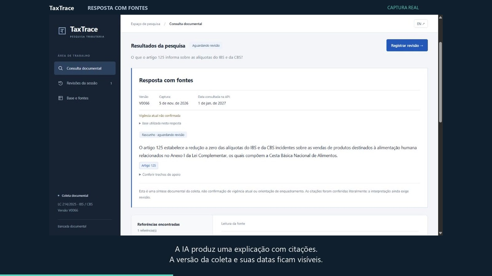
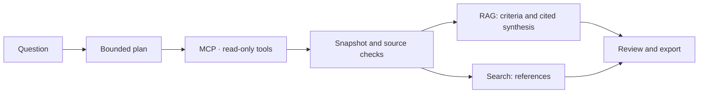

# TaxTrace

**Ask about IBS and CBS. Check the source. Preserve the review trail.**

[Live application](https://taxtrace.onrender.com/) · [Português](README.md) · [Case study](docs/case-study.md) · [Architecture](docs/architecture.md) · [Documentation](docs/README.en.md)

TaxTrace supports documentary review of Brazil's consumption tax reform. It combines article search, tax-classification lookup and AI explanations with citations, keeping sources and dataset versions visible. **Public searches require no sign-up; recording a review decision requires an authorized account.**

## In one minute

| Question | Answer |
| --- | --- |
| **What problem does it address?** | Finding a reference is only part of the task: a reviewer must inspect the text, identify its source and preserve what supported the conclusion. |
| **What was built?** | A PT-BR/EN application with search, source reader, cited RAG, execution traces and persistent document reviews. |
| **What was measured?** | Textual v4 found the expected reference in the top five in **19/20** and **11/12** positive development cases. This is not legal accuracy. |
| **What engineering does it demonstrate?** | RAG, MCP, LangGraph, comparative evaluation, persistence, access controls, Docker and Render + Neon operation. |
| **Where is the evidence?** | [Case study](docs/case-study.md), [decisions](docs/architecture.md), [quality](docs/quality.md) and [indexed runs](runs/README.md). |

## 1. The problem: a retrieved passage does not complete the analysis

**Illustrative scenario:** someone on a tax team needs to verify an IBS/CBS statement before including it in an analysis. Legal text and structured tables are different sources. An answer without origin, scope or review history makes it harder to explain what was checked later.

TaxTrace organizes that workflow: **ask → locate a reference → read the evidence → record the review → export the package**. Interpretation and responsibility remain with the person. Productivity gains and real-team use have not been measured.

## 2. Watch and try

**74-second video:** [English-captioned edition](docs/media/taxtrace-demo.en.mp4) · [Português](docs/media/taxtrace-demo.pt-BR.mp4). Edited real capture, captioned and silent; waiting time is shortened and labeled. The decision shown is an earlier operational test rejection. The captured interface and documents remain in Portuguese. [Storyboard and limits](docs/DEMONSTRACAO.md).

In the [live application](https://taxtrace.onrender.com/), switch the interface to English:

1. Choose topic search and select **Answer with sources · RAG**.
2. Enter this Portuguese example: **“O que o artigo 125 informa sobre as alíquotas do IBS e da CBS?”**
3. Open the citation, compare the excerpt and read the full article. Check the snapshot version and dates.
4. Return through **Session reviews** or export the JSON record. Decisions require reviewer authentication.

| Need | How to explore |
| --- | --- |
| Find the reference for a topic | Topic search: try `cesta básica` in direct mode |
| Understand a provision with source support | Topic search in RAG mode: use the question above |
| Read a known article | Article lookup: enter `125` |
| Inspect a classification-table entry | cClassTrib lookup: enter `000001`, preserving leading zeros |

Tab history is not conversational memory. Queries use a stored snapshot, not live legislation updates. The free service may take time to resume after inactivity. [Operating limits](docs/RENDER.md).

## 3. Where AI is used

| Mode | Model's role | Output |
| --- | --- | --- |
| **Direct search** | No model calls; rule-based plan | References and text to inspect |
| **Plan with AI** | Gemini selects an allowed lookup action | Retrieved evidence, without answer synthesis |
| **Answer with sources · RAG** | Rule-based plan; at most one Gemini synthesis call | A cited draft bound to evidence and review |

**Textual v4** remains the default retriever. Local embeddings and hybrid retrieval were implemented and compared, but performed below that baseline on known sets; they remain explicit experiments. The model does not generate unrestricted SQL. [RAG workflow and criteria](docs/RAG.md).

## 4. Results and evidence

| Verification | Recorded result | Limit |
| --- | --- | --- |
| Snapshot coverage | **580 articles, 170 classifications, 169 links and 10,515 NCM codes**; three discrepancies preserved | One snapshot, not legal-validity confirmation |
| Textual v4 retrieval | **19/20** and **11/12** references in the top five | Known development cases; no independent test |
| Documentary synthesis | **3/3** positive cases met the minimal rubric after correction; an earlier failure is preserved | Lexical and structural checks, not legal assessment |
| Linux/PostgreSQL software | **209 passing tests, three skipped**, plus **six JavaScript tests** in the recorded run | Local integration execution; the badge shows remote CI separately |
| Hosted application | Real RAG, restored review, export and authenticated technical rejection verified | Operational test, not human fiscal approval |

[Methods and failures](docs/quality.md) · [Retrieval comparison](evals/COMPARACAO.md) · [RAG evaluation](evals/RAG.md) · [Run index](runs/README.md)

Sources are **LC 214/2025 on Planalto** and tables from the **Receita Federal calculator's public API**. The reference capture is dated **November 5, 2026**, dataset **V0066**, queried for **January 1, 2027**. Capture date, API query date and legal validity are different concepts. [Scope and provenance](docs/case-study.md#fontes-e-recorte).

## 5. Engineering skills and where to inspect them

| Skill | Concrete decision | Code or evidence |
| --- | --- | --- |
| **RAG and structured outputs** | Require identified documents, literal citations and output contracts; block invalid answers | [rag.py](taxtrace/rag.py), [semantic limits](evals/RAG.md) |
| **Agents and MCP** | Typed plans, four read-only tools and at most three MCP calls per query | [agente.py](taxtrace/agente.py), [MCP server](taxtrace/servidor_mcp.py) |
| **Retrieval evaluation** | Compare textual search, embeddings and RRF before selecting a default | [Experiments](evals/), [decision](docs/architecture.md) |
| **Persistent review** | Pause and resume the graph against an evidence hash, without repeating tools or model calls | [revisao.py](taxtrace/revisao.py), [checkpoints](taxtrace/checkpoints.py) |
| **Auditable data** | Manifests, transactional loading and original-source preservation in PostgreSQL | [integridade.py](taxtrace/integridade.py), [fontes.py](taxtrace/fontes.py) |
| **API and access controls** | Secure cookies, CSRF, browser-owned reviews and authenticated decisions | [web.py](taxtrace/web.py), [authorization](docs/AUTORIZACAO.md) |
| **Applied AI operations** | Secret-free image, separate database roles, Neon state and Render Blueprint | [Dockerfile](Dockerfile), [render.yaml](render.yaml), [operations](docs/RENDER.md) |

## 6. Run and explore

Use the live app to try the workflow. To reproduce it, follow [development](docs/development.md): Python 3.14, Docker/PostgreSQL, private configuration and source loading. Direct mode needs no model key; Gemini planning and RAG do.

| Location | Responsibility |
| --- | --- |
| [`taxtrace/`](taxtrace/) | Collection, domain, retrieval, RAG, graph and application |
| [`taxtrace/static/`](taxtrace/static/) | PT-BR/EN interface and HTTP client |
| [`tests/`](tests/) | Contracts, failure cases, input protections and integration |
| [`evals/`](evals/) | Rubrics, datasets and retrieval/generation comparisons |
| [`runs/`](runs/README.md) | Preserved evidence with a stage-based index |
| [`docs/`](docs/README.en.md) | Business case, decisions, reproduction and operations |
| [`scripts/`](scripts/) | Explicit operational verification commands |
| [`PLANO.md`](PLANO.md) | Scope, decisions and pending work; not evidence by itself |

Secrets, local databases, weights and raw downloads are excluded from Git. Hosted snapshot originals are preserved in Neon. [Contributing](CONTRIBUTING.md).

## 7. Limits

- No tax calculation, product classification advice or confirmation of current legal validity.
- A literal citation and matching numbers do not prove that a paraphrase is correct; adversarial evaluation documents this limit.
- No independent expert evaluation, multi-reviewer account management or measured productivity gain.
- One administrative reviewer account; usage counters and authenticated sessions are in one process's memory and reset on restart.
- Hashes check consistency with the manifest; they are not signatures or protection against an administrator controlling sources and storage.

Developed by Luiz Nelson with AI assistance. Responsibility for understanding, review and verification remains with the maintainer. The [MIT license](LICENSE) covers code; public sources have their own provenance and conditions. Detailed technical guides are primarily in Portuguese; the English documentation index identifies the relevant reading paths.
