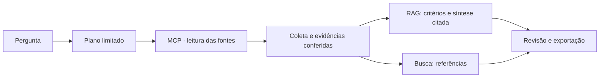

# TaxTrace

**Pergunte sobre IBS e CBS. Confira a fonte. Preserve o que foi revisado.**

[Aplicação publicada](https://taxtrace.onrender.com/) · [English](README.en.md) · [Estudo de caso](docs/case-study.md) · [Arquitetura](docs/architecture.md) · [Documentação](docs/README.md)

O TaxTrace apoia a conferência documental da Reforma Tributária do consumo. Reúne pesquisa de artigos, consulta de classificações tributárias e explicações de IA com citações, mantendo a origem e a versão dos dados acessíveis. **A consulta pública não exige cadastro; aprovar ou rejeitar uma revisão exige conta autorizada.**

## Em um minuto

| Pergunta | Resposta |
| --- | --- |
| **Qual problema resolve?** | Localizar uma referência é apenas parte da tarefa: é preciso conferir o texto, identificar a fonte e registrar o que sustentou uma conclusão. |
| **O que foi construído?** | Aplicação PT-BR/EN com busca, leitor de fontes, RAG citado, rastro das etapas e revisão documental persistida. |
| **O que foi medido?** | A busca textual v4 localizou a referência entre os cinco primeiros em **19/20** e **11/12** casos positivos de desenvolvimento. Isso não mede precisão jurídica. |
| **O que a engenharia demonstra?** | RAG, MCP, LangGraph, avaliação comparativa, persistência, controle de acesso, Docker e operação com Render + Neon. |
| **Onde conferir?** | [Caso de uso](docs/case-study.md), [decisões técnicas](docs/architecture.md), [qualidade](docs/quality.md) e [evidências indexadas](runs/README.md). |

## 1. O problema: encontrar um trecho não encerra a análise

**Cenário ilustrativo:** uma pessoa da área fiscal precisa conferir uma informação sobre IBS e CBS antes de incluí-la em uma análise. O texto legal e as tabelas são fontes diferentes. Uma resposta sem origem, recorte ou registro da revisão dificulta explicar o que foi conferido depois.

A proposta do TaxTrace é organizar esse percurso: **perguntar → localizar a referência → ler a evidência → registrar a revisão → exportar o conjunto**. A interpretação e a responsabilidade pela decisão continuam com a pessoa. Não foram medidos ganhos de produtividade nem validado o uso por uma equipe fiscal.

## 2. Veja e experimente

**Vídeo de 74 s:** [português](docs/media/taxtrace-demo.pt-BR.mp4) · [English captions](docs/media/taxtrace-demo.en.mp4). Captura real editada, com legendas e sem áudio; espera encurtada e identificada. A decisão exibida é um registro anterior de rejeição de teste. [Roteiro e limites](docs/DEMONSTRACAO.md).

Na [aplicação publicada](https://taxtrace.onrender.com/):

1. Escolha **Pesquisar um tema → Resposta com fontes · RAG**.
2. Pergunte: **“O que o artigo 125 informa sobre as alíquotas do IBS e da CBS?”**
3. Abra a citação, compare o trecho e leia o artigo integral. Confira versão e datas da coleta.
4. Retome a consulta em **Revisões da sessão** ou baixe o registro JSON. Decisões ficam restritas ao revisor autenticado.

| Necessidade | Como explorar |
| --- | --- |
| Localizar a referência de um assunto | **Pesquisar um tema**: tente `cesta básica` com busca direta |
| Entender um dispositivo com apoio das fontes | **Pesquisar um tema → Resposta com fontes · RAG**: use a pergunta acima |
| Conferir um artigo conhecido | **Abrir um artigo**: informe `125` |
| Consultar uma classificação da tabela | **Consultar cClassTrib**: informe `000001`, preservando os zeros |

O histórico pertence à aba; não é memória de conversa. As consultas usam uma coleta armazenada, não legislação atualizada em tempo real. O serviço gratuito pode levar um tempo para reativar após inatividade. [Operação e limites](docs/RENDER.md).

## 3. Onde entra a IA

| Modo | Papel do modelo | Resultado |
| --- | --- | --- |
| **Busca direta** | Nenhuma chamada ao modelo; plano por regras | Referências e textos para conferir |
| **Planejar consulta com IA** | Gemini escolhe uma ação de consulta permitida | Evidências recuperadas, sem síntese da resposta |
| **Resposta com fontes · RAG** | Plano por regras; até uma chamada Gemini para síntese | Rascunho citado, vinculado às evidências e à revisão |

A recuperação padrão é **textual v4**. Embeddings e busca híbrida foram implementados e comparados, mas ficaram abaixo dessa referência nos conjuntos conhecidos; permanecem experimentos explícitos. Não há SQL livre gerado pelo modelo. [Fluxo e critérios do RAG](docs/RAG.md).

## 4. Resultados e evidências

| O que foi verificado | Resultado registrado | Limite da conclusão |
| --- | --- | --- |
| Cobertura da captura | **580 artigos, 170 classificações, 169 ligações e 10.515 NCM**; três divergências preservadas | Cobertura de uma coleta, não confirmação de vigência |
| Recuperação textual v4 | **19/20** e **11/12** referências no top 5 | Casos conhecidos de desenvolvimento; sem teste independente |
| Síntese documental | **3/3** casos positivos atenderam ao gabarito mínimo após correção; primeira rodada teve falha preservada | Checagem lexical e estrutural, não avaliação jurídica |
| Software em Linux/PostgreSQL | **209 testes aprovados, três desativados**, mais **seis testes JavaScript** na rodada registrada | Execução local de integração; o badge mostra o CI remoto separadamente |
| Aplicação hospedada | RAG real, recuperação da revisão, exportação e rejeição técnica autenticada conferidos | Teste operacional, sem aprovação fiscal humana |

[Metodologia e falhas](docs/quality.md) · [Comparação de busca](evals/COMPARACAO.md) · [Avaliação do RAG](evals/RAG.md) · [Índice das execuções](runs/README.md)

As fontes são a **LC 214/2025, no Planalto**, e tabelas da **API pública da calculadora da Receita Federal**. A captura de referência é de **05/11/2026**, base **V0066**, com data consultada na API **01/01/2027**. Data da captura, data consultada e vigência têm significados diferentes. [Origem e escopo](docs/case-study.md#fontes-e-recorte).

## 5. Habilidades demonstradas — e onde conferir

| Habilidade | Decisão concreta | Código ou evidência |
| --- | --- | --- |
| **RAG e saídas estruturadas** | Exigir documento identificado, citações literais e contrato de saída; bloquear respostas inválidas | [rag.py](taxtrace/rag.py), [limites semânticos](evals/RAG.md) |
| **Agentes e MCP** | Plano tipado, quatro ferramentas de leitura e até três chamadas MCP por consulta | [agente.py](taxtrace/agente.py), [servidor MCP](taxtrace/servidor_mcp.py) |
| **Avaliação de recuperação** | Comparar textual, embeddings e RRF antes de escolher o padrão | [Experimentos](evals/), [decisão](docs/architecture.md) |
| **Revisão com persistência** | Pausar o grafo e retomar pelo hash do conjunto, sem repetir modelo ou ferramentas | [revisao.py](taxtrace/revisao.py), [checkpoints](taxtrace/checkpoints.py) |
| **Dados auditáveis** | Captura com manifesto, carga transacional e originais preservados no PostgreSQL | [integridade.py](taxtrace/integridade.py), [fontes.py](taxtrace/fontes.py) |
| **API e controle de acesso** | Cookies seguros, CSRF, vínculo da consulta à sessão e decisão restrita ao revisor | [web.py](taxtrace/web.py), [autorização](docs/AUTORIZACAO.md) |
| **Operação de IA aplicada** | Imagem sem segredos, acessos de banco separados, estado no Neon e Blueprint Render | [Dockerfile](Dockerfile), [render.yaml](render.yaml), [operação](docs/RENDER.md) |

## 6. Executar e investigar o repositório

Para experimentar, use o app publicado. Para reproduzir, siga o [guia de desenvolvimento](docs/development.md): Python 3.14, Docker/PostgreSQL, configuração privada e carga das fontes. O modo direto não exige chave de modelo; Gemini e RAG exigem a configuração correspondente.

| Local | Responsabilidade |
| --- | --- |
| [`taxtrace/`](taxtrace/) | Coleta, domínio, consultas, RAG, grafo e aplicação |
| [`taxtrace/static/`](taxtrace/static/) | Interface e cliente HTTP PT-BR/EN |
| [`tests/`](tests/) | Contratos, falhas, segurança das entradas e integrações |
| [`evals/`](evals/) | Gabaritos, metodologia e comparação de recuperação/geração |
| [`runs/`](runs/README.md) | Evidências históricas preservadas e índice por etapa |
| [`docs/`](docs/README.md) | Caso de uso, decisões, reprodução e operação |
| [`scripts/`](scripts/) | Verificações operacionais explícitas |
| [`PLANO.md`](PLANO.md) | Escopo, decisões e pendências; não substitui evidência de entrega |

Credenciais, bancos locais, pesos e downloads brutos ficam fora do Git. As fontes da captura hospedada estão preservadas no Neon. [Como contribuir](CONTRIBUTING.md).

## 7. Limites da entrega

- Não calcula tributos, enquadra produtos ou confirma vigência jurídica atual.
- Citação literal e números presentes não provam que a paráfrase está correta; a avaliação adversarial documenta esse limite.
- Não há validação independente por especialista, gestão de múltiplos revisores ou medição de economia de trabalho.
- Há uma conta administrativa de revisão; limites de consumo e sessões autenticadas usam memória de uma instância e reiniciam com o processo.
- O hash confere correspondência ao manifesto; não é assinatura digital nem proteção contra quem controla o banco e os arquivos.

Desenvolvido por Luiz Nelson, com assistência de IA. A responsabilidade por compreender, revisar e verificar a entrega permanece com o mantenedor. A [licença MIT](LICENSE) cobre o código; as fontes públicas têm origem e condições próprias.
