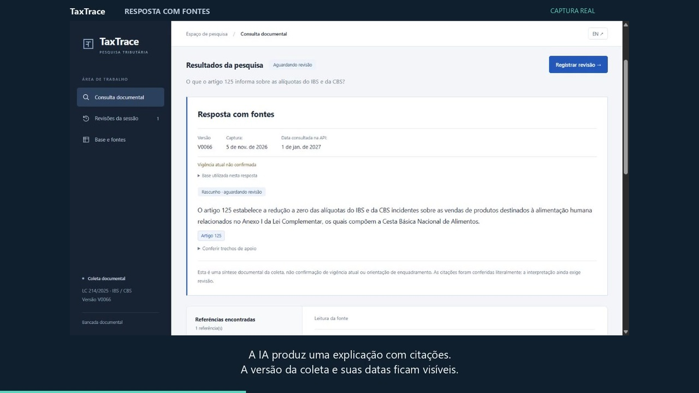
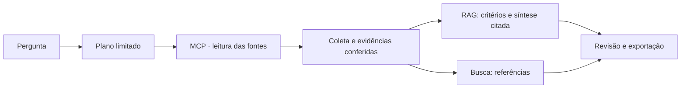

# TaxTrace

**Pergunte sobre IBS e CBS. Confira a fonte. Preserve o que foi revisado.**

[Aplicação publicada](https://taxtrace.onrender.com/) · [English](README.en.md) · [Estudo de caso](docs/case-study.md) · [Arquitetura](docs/architecture.md) · [Documentação](docs/README.md)

O TaxTrace apoia a conferência documental da Reforma Tributária do consumo. Reúne pesquisa de artigos, consulta de classificações tributárias e explicações de IA com citações, mantendo a origem e a versão dos dados acessíveis. **A consulta pública não exige cadastro; aprovar ou rejeitar uma revisão exige conta autorizada.**

## Em um minuto

| | |
| --- | --- |
| **Problema** | Na análise fiscal, achar o trecho é só o começo: é preciso mostrar de onde ele veio, o que foi conferido e quem decidiu. |
| **Restrições** | A resposta precisa ser rastreável até a fonte, o modelo não pode decidir enquadramento e o serviço roda em hospedagem gratuita (Render + Neon). |
| **Decisão central** | Tratar o LLM como redator de um rascunho citado, não como fonte. A captura identificada vem antes da IA; o planejador só acessa consultas de domínio por um servidor MCP somente leitura, sem SQL livre; e cada decisão de revisão fica presa ao hash do conjunto exibido. |
| **Resultado medido** | A busca textual v4 colocou a referência entre as cinco primeiras em **19/20** e **11/12** casos de desenvolvimento. Embeddings e busca híbrida (RRF) foram implementados, ficaram abaixo e seguem como experimento. Isso não mede precisão jurídica. |
| **Próxima decisão pendente** | Limites de uso e sessões autenticadas estão na memória de uma instância; escalar exige mover esse estado para o banco. |
| **Onde conferir** | [Decisões de arquitetura](#5-decisões-de-arquitetura-e-trade-offs), [arquitetura completa](docs/architecture.md), [qualidade](docs/quality.md) e [evidências](runs/README.md). |

## 1. O problema: encontrar um trecho não encerra a análise

**Cenário ilustrativo:** uma pessoa da área fiscal precisa conferir uma informação sobre IBS e CBS antes de incluí-la em uma análise. O texto legal e as tabelas são fontes diferentes. Uma resposta sem origem, recorte ou registro da revisão dificulta explicar o que foi conferido depois.

A proposta do TaxTrace é organizar esse percurso: **perguntar → localizar a referência → ler a evidência → registrar a revisão → exportar o conjunto**. A interpretação e a responsabilidade pela decisão continuam com a pessoa. Não foram medidos ganhos de produtividade nem validado o uso por uma equipe fiscal.

## 2. Veja e experimente

**Vídeo de 74 s:** [português](docs/media/taxtrace-demo.pt-BR.mp4) · [English captions](docs/media/taxtrace-demo.en.mp4). Captura real editada, com legendas e sem áudio; espera encurtada e identificada. A decisão exibida é um registro anterior de rejeição de teste. [Roteiro e limites](docs/DEMONSTRACAO.md).

Na [aplicação publicada](https://taxtrace.onrender.com/):

1. Escolha **Pesquisar um tema → Resposta com fontes · RAG**.
2. Pergunte: **“O que o artigo 125 informa sobre as alíquotas do IBS e da CBS?”**
3. Abra a citação, compare o trecho e leia o artigo integral. Confira versão e datas da coleta.
4. Retome a consulta em **Revisões da sessão** ou baixe o registro JSON. Decisões ficam restritas ao revisor autenticado.

| Necessidade | Como explorar |
| --- | --- |
| Localizar a referência de um assunto | **Pesquisar um tema**: tente `cesta básica` com busca direta |
| Entender um dispositivo com apoio das fontes | **Pesquisar um tema → Resposta com fontes · RAG**: use a pergunta acima |
| Conferir um artigo conhecido | **Abrir um artigo**: informe `125` |
| Consultar uma classificação da tabela | **Consultar cClassTrib**: informe `000001`, preservando os zeros |

O histórico pertence à aba; não é memória de conversa. As consultas usam uma coleta armazenada, não legislação atualizada em tempo real. O serviço gratuito pode levar um tempo para reativar após inatividade. [Operação e limites](docs/RENDER.md).

## 3. Onde entra a IA

| Modo | Papel do modelo | Resultado |
| --- | --- | --- |
| **Busca direta** | Nenhuma chamada ao modelo; plano por regras | Referências e textos para conferir |
| **Planejar consulta com IA** | Gemini escolhe uma ação de consulta permitida | Evidências recuperadas, sem síntese da resposta |
| **Resposta com fontes · RAG** | Plano por regras; até uma chamada Gemini para síntese | Rascunho citado, vinculado às evidências e à revisão |

A recuperação padrão é **textual v4**. Embeddings e busca híbrida foram implementados e comparados, mas ficaram abaixo dessa referência nos conjuntos conhecidos; permanecem experimentos explícitos. Não há SQL livre gerado pelo modelo. [Fluxo e critérios do RAG](docs/RAG.md).

## 4. Resultados e evidências

| O que foi verificado | Resultado registrado | Limite da conclusão |
| --- | --- | --- |
| Cobertura da captura | **580 artigos, 170 classificações, 169 ligações e 10.515 NCM**; três divergências preservadas | Cobertura de uma coleta, não confirmação de vigência |
| Recuperação textual v4 | **19/20** e **11/12** referências no top 5 | Casos conhecidos de desenvolvimento; sem teste independente |
| Síntese documental | **3/3** casos positivos atenderam ao gabarito mínimo após correção; primeira rodada teve falha preservada | Checagem lexical e estrutural, não avaliação jurídica |
| Software em Linux/PostgreSQL | **209 testes aprovados, três desativados**, mais **seis testes JavaScript** na rodada registrada | Execução local de integração; o badge mostra o CI remoto separadamente |
| Aplicação hospedada | RAG real, recuperação da revisão, exportação e rejeição técnica autenticada conferidos | Teste operacional, sem aprovação fiscal humana |

[Metodologia e falhas](docs/quality.md) · [Comparação de busca](evals/COMPARACAO.md) · [Avaliação do RAG](evals/RAG.md) · [Índice das execuções](runs/README.md)

As fontes são a **LC 214/2025, no Planalto**, e tabelas da **API pública da calculadora da Receita Federal**. A captura de referência é de **05/11/2026**, base **V0066**, com data consultada na API **01/01/2027**. Data da captura, data consultada e vigência têm significados diferentes. [Origem e escopo](docs/case-study.md#fontes-e-recorte).

## 5. Decisões de arquitetura e trade-offs

Cada linha é uma escolha registrada em [docs/architecture.md](docs/architecture.md), com o motivo e o que ela custou.

| Decisão | Por quê | Custo aceito | Evidência |
| --- | --- | --- | --- |
| **Captura identificada antes da IA** | Uma resposta precisa apontar para bytes e recorte conferíveis | Os dados são de uma coleta datada; não confirmam vigência atual | [integridade.py](taxtrace/integridade.py) |
| **Consultas de domínio por MCP somente leitura, sem SQL livre** | Limitar o que o planejador pode pedir ao banco | Menos flexibilidade que uma pergunta SQL aberta | [consultas.py](taxtrace/consultas.py), [servidor MCP](taxtrace/servidor_mcp.py) |
| **Busca textual v4 como padrão; embeddings (E5, pgvector) e RRF como experimentos** | Foi a melhor nos conjuntos medidos (19/20 e 11/12); trocar por novidade sem ganho medido não se justificava | Não melhora a ordem quando a lista já está cheia; os pesos não entram na imagem pública | [Comparação](evals/COMPARACAO.md) |
| **Síntese com citação literal e validação estrutural** | Ligar cada afirmação a um trecho disponível e bloquear saídas inválidas | Literalidade não prova que a paráfrase está certa; implicação semântica ainda exige revisão humana | [rag.py](taxtrace/rag.py), [limites](evals/RAG.md) |
| **Pausar o grafo LangGraph e decidir pelo hash do conjunto** | Evitar aprovar uma resposta ou evidência diferente da exibida, sem repetir modelo nem ferramentas | Uma mudança de código pode exigir nova revisão | [revisao.py](taxtrace/revisao.py), [checkpoints](taxtrace/checkpoints.py) |
| **Dois papéis de banco: leitura das fontes e escrita do estado** | O MCP recebe só leitura; o servidor web não recebe a credencial administrativa | Mais credenciais para configurar e operar | [Neon](docs/NEON.md) |
| **PostgreSQL hospedado em vez de disco local** | O disco efêmero do plano gratuito não preserva revisões | Dependência de um banco externo | [Persistência](docs/PERSISTENCIA.md) |
| **Uma instância, um worker** | Limites e sessões ficam em memória, de forma simples | Não é distribuído; reiniciar zera limites e exige novo login | [Operação](docs/RENDER.md) |

## 6. Executar e investigar o repositório

Para experimentar, use o app publicado. Para reproduzir, siga o [guia de desenvolvimento](docs/development.md): Python 3.14, Docker/PostgreSQL, configuração privada e carga das fontes. O modo direto não exige chave de modelo; Gemini e RAG exigem a configuração correspondente.

| Local | Responsabilidade |
| --- | --- |
| [`taxtrace/`](taxtrace/) | Coleta, domínio, consultas, RAG, grafo e aplicação |
| [`taxtrace/static/`](taxtrace/static/) | Interface e cliente HTTP PT-BR/EN |
| [`tests/`](tests/) | Contratos, falhas, segurança das entradas e integrações |
| [`evals/`](evals/) | Gabaritos, metodologia e comparação de recuperação/geração |
| [`runs/`](runs/README.md) | Evidências históricas preservadas e índice por etapa |
| [`docs/`](docs/README.md) | Caso de uso, decisões, reprodução e operação |
| [`scripts/`](scripts/) | Verificações operacionais explícitas |
| [`PLANO.md`](PLANO.md) | Escopo, decisões e pendências; não substitui evidência de entrega |

Credenciais, bancos locais, pesos e downloads brutos ficam fora do Git. As fontes da captura hospedada estão preservadas no Neon. [Como contribuir](CONTRIBUTING.md).

## 7. Limites da entrega

- Não calcula tributos, enquadra produtos ou confirma vigência jurídica atual.
- Citação literal e números presentes não provam que a paráfrase está correta; a avaliação adversarial documenta esse limite.
- Não há validação independente por especialista, gestão de múltiplos revisores ou medição de economia de trabalho.
- Há uma conta administrativa de revisão; limites de consumo e sessões autenticadas usam memória de uma instância e reiniciam com o processo.
- O hash confere correspondência ao manifesto; não é assinatura digital nem proteção contra quem controla o banco e os arquivos.

Desenvolvido por Luiz Nelson, com assistência de IA. A responsabilidade por compreender, revisar e verificar a entrega permanece com o mantenedor. A [licença MIT](LICENSE) cobre o código; as fontes públicas têm origem e condições próprias.
