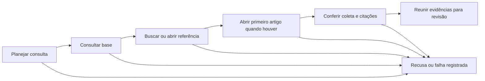

# Fluxo LangGraph para reunir evidências

## O problema que esta etapa resolve

Para conferir uma dúvida, a pessoa precisa saber qual base foi usada, localizar uma referência e abrir o documento. Fazer essas consultas separadamente pode misturar coletas ou perder a origem dos dados. O fluxo LangGraph encadeia as ferramentas MCP e deixa um registro do caminho percorrido.

Ele entrega **evidências para revisão**, não uma conclusão tributária. O modo local segue regras de entrada. O modo Gemini usa um modelo real para escolher uma ação limitada; os passos seguintes são executados e conferidos pelo código.



## O que o planejador pode fazer

O plano tem schema validado e apenas quatro ações: buscar termos, ler um artigo mencionado explicitamente, consultar um código cClassTrib mencionado explicitamente ou recusar. O modelo não recebe SQL nem acesso a arquivos. Uma referência de artigo ou código proposta pelo modelo precisa existir na pergunta antes de ser usada em consulta direta. Isso evita executar uma referência inventada; não garante que o plano inteiro seja pertinente.

O modo local reconhece referências explícitas como “artigo 125” e “cClassTrib 000001”. Sem referência explícita, usa a pergunta como busca textual. Referências múltiplas ambíguas são recusadas por esse roteador limitado. Ele não faz interpretação semântica de escopo e não deve ser apresentado como um agente LLM.

No modo Gemini, somente a pergunta e as instruções de roteamento são enviadas ao provedor. Documentos recuperados não são enviados para síntese nesta etapa. O modelo configurado é `gemini-3.5-flash-lite`; o identificador e o uso de tokens informado pela API ficam no registro. O adaptador usa o [contrato REST oficial](https://ai.google.dev/api/generate-content) com saída JSON validada. A [página de preços](https://ai.google.dev/gemini-api/docs/pricing#gemini-3.5-flash-lite) informa uma faixa gratuita, mas as cotas e a modalidade da conta continuam sendo condições do provedor. Não medimos o faturamento da conta.

## Limites da execução

- Até uma chamada de planejamento por IA e três chamadas MCP por execução, sem retries automáticos.
- Primeiro consulta a base; depois fixa o ID e confere também o hash do manifesto e a data consultada nas respostas seguintes.
- Para buscar, usa a textual v4 com até três candidatos. Pode abrir o primeiro artigo para leitura de até 3.000 caracteres. A escolha do primeiro candidato é determinística e não comprova relevância.
- Conferência de URLs e hashes das citações contra as fontes da coleta; consistência de artigo citado e intervalo de página.
- Limites de tempo no provedor e no cliente MCP; instruções SQL continuam limitadas pelo servidor.
- Falhas de MCP, coleta divergente e referências inconsistentes encerram a tentativa como falha. Não são convertidas em ausência de resultado.
- Não há envio de rastros para LangSmith nesta execução: o contexto de tracing é desativado explicitamente. Os registros ficam em arquivos locais.

A conferência do grafo verifica identificadores e metadados; não substitui a avaliação de trechos contra o corpus nem valida a interpretação jurídica. As ferramentas leem o banco com o papel restrito já implementado. Aprovação humana, parecer fiscal e escrita na base não são operações deste fluxo.

## Como executar

Com o PostgreSQL e a coleta preparados:

```powershell
.venv/Scripts/python.exe -m pip install -r requirements.txt
.venv/Scripts/python.exe -m taxtrace.agente --consulta "cesta basica"
.venv/Scripts/python.exe -m taxtrace.agente --consulta "Leia o artigo 125."
.venv/Scripts/python.exe -m taxtrace.agente --consulta "Consulte o cClassTrib 000001."
```

O padrão é `--modo local`, sem chamada de modelo. O processo inicia e encerra o servidor MCP automaticamente. Para usar o planejador Gemini, configure apenas no `.env` local:

```dotenv
GEMINI_API_KEY=sua_chave_local
GEMINI_MODEL=gemini-3.5-flash-lite
```

```powershell
.venv/Scripts/python.exe -m taxtrace.agente --modo gemini --consulta "Qual artigo trata da cesta basica nacional de alimentos?"
```

Não publique a chave. `--coleta ID` permite escolher uma coleta existente. O nome do modelo é um identificador do provedor, não uma garantia de pesos imutáveis. Ausência de chave, limite de API e JSON inválido são falhas explícitas; o comando não troca silenciosamente para outro provedor ou para o modo local.

## Como acompanhar o que aconteceu

Cada tentativa concluída pelo grafo grava `runs/agente-<UUID>/execucao.json`, incluindo pergunta, modo, plano, metadados do planejador, coleta, respostas das ferramentas, rastro ordenado, tempo das chamadas, hash das respostas MCP e hashes do código. Use somente dados públicos: esses arquivos podem ser incluídos no Git após revisão. Nenhuma chave ou string de conexão é incluída pelo código.

Os resultados possíveis distinguem evidências para revisão, referência não encontrada nesta consulta, recusa do planejador e falha de execução. `suficiencia_para_resposta` permanece `nao_avaliada`. Os campos `resposta_fiscal_gerada` e `aprovacao_humana_realizada` permanecem falsos. Um status de revisão não significa que a análise fiscal terminou.

A [entrega registrada](../runs/2026-11-06-langgraph-delivery/verificacao.json) aponta os testes e todas as execuções desta etapa, incluindo as preliminares. Foram testados com MCP real os caminhos de busca, leitura, classificação geral, código ausente e termo sem correspondência. Houve três chamadas reais ao Gemini: leitura de artigo explícito, escolha de busca e recusa de uma solicitação para revelar credenciais. Um caso de recusa observado não demonstra resistência geral a prompt injection nem acurácia de escopo.

Os testes automatizados usam clientes e planejadores sintéticos identificados nas fixtures para simular falha operacional, coleta divergente, citação adulterada, referência inventada, excesso de ações e HTTP 429 sem retry. O CI não chama o Gemini e não usa a chave do desenvolvedor. A execução do CI remoto não foi observada nesta entrega.

## Revisão persistente disponível

O [módulo de revisão](REVISAO.md) já permite salvar a pausa em SQLite, inspecionar o conjunto e retomar com uma decisão declarada. Use `python -m taxtrace.revisao iniciar` com o Python da `.venv`; o comando `taxtrace.agente` continua sendo a execução direta sem pausa.

## O que ainda falta

A execução direta deste módulo não tem memória de conversa ou síntese fiscal. O checkpoint e a pausa para revisão estão implementados separadamente em `taxtrace.revisao`, conforme [REVISAO.md](REVISAO.md). Os arquivos JSON são evidências de execução, não checkpoints que permitam retomar o grafo. Ainda falta avaliar planejamento e recusa com uma amostra independente e revisar suficiência, vigência e citações antes de gerar uma resposta.

A integração usa o [Graph API do LangGraph](https://docs.langchain.com/oss/python/langgraph/graph-api). A pausa e a retomada agora estão disponíveis no módulo de revisão. Faltam interface e autenticação de revisores; aprovação de fluxo não comprova correção tributária.
