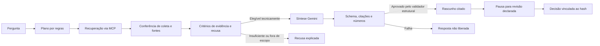

# Resposta documental com fontes (RAG)

## Problema e entrega

Encontrar um artigo não basta para entender como ele se relaciona à pergunta. O modo **Resposta com fontes · RAG** transforma a recuperação em uma explicação curta, com uma citação verificável junto de cada afirmação. A pessoa abre o trecho de apoio, confere a fonte e registra sua revisão. A proposta é facilitar essa conferência; não há economia de tempo medida nem validação por equipe fiscal.

Não é calculadora nem serviço de enquadramento tributário. A aplicação não confirma a vigência jurídica atual. O recorte e as datas continuam visíveis: data consultada na API e captura são conceitos diferentes.

## Fluxo implementado



A recuperação padrão continua sendo a textual v4, escolhida pelos resultados dos experimentos anteriores. Embeddings/pgvector e RRF permanecem experimentais. RAG não depende de escolher uma recuperação vetorial inferior só para usar a tecnologia.

O modo `local` não chama modelo. O modo `gemini` existente usa IA no planejamento, sem síntese. O modo `rag` usa planejamento por regras e **até uma chamada de síntese**, sem retry ou fallback silencioso. A consulta usa até três ferramentas MCP. Para síntese, a leitura de artigo passa de 3.000 a até 8.000 caracteres, limite já permitido pelo servidor. Artigos ainda parciais não são enviados para geração nesta versão.

## Critérios anteriores à geração

- Precisa haver artigo completo na leitura recuperada ou descrição estruturada de classificação identificada na fonte.
- Pergunta sobre vigência atual ou data futura, cálculo individual, produto/NCM ou enquadramento é recusada.
- Solicitação de lista de produtos/itens que exija anexo não recuperado é recusada.
- Histórico de redação riscada no artigo bloqueia síntese automática nesta versão.
- Instruções suspeitas na pergunta ou evidência são bloqueadas por regras limitadas. Isso não demonstra resistência geral a prompt injection.
- Fontes e hash do contexto precisam coincidir com os registros; tamanho do contexto é limitado a 12 mil caracteres.

Esses critérios são **elegibilidade técnica**, não uma declaração de suficiência jurídica. O modelo também pode responder `evidencia_insuficiente` quando o documento admitido não cobre a pergunta. A avaliação especializada ainda está pendente.

## Geração e validação

`taxtrace/rag.py` solicita JSON com status e afirmações; cada afirmação exige pelo menos uma citação com ID do documento e trecho literal. O adaptador usa o contrato [generateContent](https://ai.google.dev/api/generate-content) e [saída estruturada](https://ai.google.dev/gemini-api/docs/structured-output?lang=rest) do Gemini. A chave só aparece no cabeçalho da requisição; não é incluída no prompt ou nos registros.

O código verifica schema, status, hash do contexto, IDs, presença exata do trecho no texto recebido, números e referências citadas. Não aceita uma recusa com afirmações escondidas. Timeout, HTTP 429, JSON inválido, saída incompleta e citação adulterada são falhas explícitas. A saída rejeitada não é mostrada como resposta.

**Uma citação literal não prova que a paráfrase é semanticamente correta.** O validador não é uma prova de implicação lógica ou jurídica. A interface apresenta um rascunho e exige conferência humana; a avaliação lexical tem limites explicitados em [evals/RAG.md](../evals/RAG.md).

## Revisão e rastreabilidade

O conjunto revisado inclui pergunta, modo, plano, coleta, respostas MCP e `rag`: critérios, contexto, afirmações, citações e metadados de geração. Alterar uma afirmação ou citação altera o hash exigido na decisão. Não há nova chamada de modelo ou ferramenta na retomada.

O registro contém versão/hash do prompt, modelo solicitado/retornado quando informado, uso de tokens informado pelo provedor e rastros de duração. Não se afirma custo zero, pesos imutáveis ou ausência de cobrança da conta. O texto completo de apoio continua sendo uma leitura complementar separada do conjunto original.

O formato de checkpoint passou à versão 2. Revisões anteriores continuam consultáveis, mas mudança de código impede nova decisão sobre um fluxo antigo. Nenhum histórico é apagado ou migrado silenciosamente. Na CLI, a identidade do operador é declarada; na interface web, a decisão exige a conta autenticada e o nome é atribuído pelo servidor. Identidade civil e qualificação não são verificadas. Ver [autenticação](AUTENTICACAO.md). Decisões sintéticas da CLI usam origem `teste_automatizado`.

## Como usar

Na aplicação local ou publicada, escolha **Pesquisar um tema → Como executar → Resposta com fontes · RAG**. Pergunte, por exemplo: **“O que o artigo 125 informa sobre as alíquotas do IBS e da CBS?”**. Clique na citação para abrir e destacar o trecho, e revise resposta e evidências antes de decidir. O conteúdo gerado permanece em português, como o fluxo e a documentação das fontes, mesmo quando os controles estão em inglês.

```powershell
.venv/Scripts/python.exe -m taxtrace.revisao iniciar --modo rag --consulta "O que o artigo 125 informa sobre as alíquotas do IBS e da CBS?"
```

Reutiliza `GEMINI_API_KEY` e `GEMINI_MODEL` configurados no `.env`. `GEMINI_RAG_MODEL` é opcional; vazio reutiliza o modelo existente. Não envie chaves ao chat ou ao Git.

## O que ainda falta

- Avaliação independente e revisão fiscal dos gabaritos e respostas.
- Validação temporal por dispositivo/data, atualização de fontes e cobertura dos anexos necessários.
- Gestão de múltiplas contas de revisor e avaliação operacional com usuários.

A aplicação foi publicada com conta de revisor, vínculo de sessão e limites de consumo. O RAG hospedado e uma rejeição técnica autenticada foram conferidos; o [vídeo](DEMONSTRACAO.md) apresenta essa jornada. Isso não encerra as pendências de avaliação fiscal ou validação temporal.

## Registro da entrega

A [verificação local](../runs/2026-11-06-rag-delivery/verification.md) reúne testes, capturas, saídas e decisão sintética. As falhas preliminares estão preservadas.

## Ampliação da avaliação e metadados

A comparação numérica passou a usar tokens completos e códigos são conferidos pela identidade, sem aceitar prefixos. A avaliação adversarial explicita também os limites de interpretação que exigem revisão. A interface apresenta versão e datas da coleta junto da resposta; não infere vigência a partir delas. Veja a [rubrica de revisão](REVISAO_AVALIACAO.md) e a [metodologia ampliada](../evals/RAG.md).
