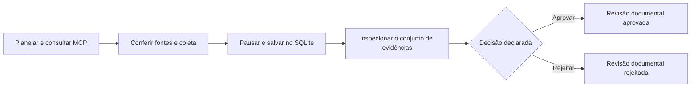

# Revisão documental com pausa e retomada

## Atualização: RAG documental

O modo `rag` acrescenta triagem técnica e síntese Gemini com citações. Resposta, contexto e citações integram o hash da revisão (checkpoint v2). O modo direto e o planejador existente permanecem disponíveis. Recusas ou falhas de geração não são encaminhadas como respostas aprováveis. Ver [RAG.md](RAG.md) e [avaliação](../evals/RAG.md). As seções históricas abaixo descrevem a entrega documental anterior; seus resultados não substituem a validação do RAG.


## Por que existe esta etapa

Uma execução pode reunir documentos sem que alguém já tenha conferido o material. O fluxo de revisão mantém essa diferença explícita: o sistema recupera as evidências, salva um retrato da consulta e pausa. Um operador pode abrir esse material e registrar sua decisão depois, inclusive em outro processo.

A decisão aprova ou rejeita o **conjunto documental daquela consulta**. Não aprova o enquadramento fiscal de um produto, não comprova vigência e não libera geração de parecer tributário.



## O que funciona

- Interrupção dinâmica com `interrupt()` e retomada com `Command(resume=...)`, conforme a [documentação do LangGraph](https://docs.langchain.com/oss/python/langgraph/interrupts).
- Checkpointer SQLite local: o estado permanece após fechar o processo. O armazenamento fica em `data/checkpoints/revisoes.sqlite3`, fora do Git.
- UUID próprio por revisão, sem reutilizar outra sessão como continuação.
- Hash do conjunto de evidências exigido na decisão. Um hash diferente é recusado antes da retomada.
- Trava local por revisão durante inspeção e decisão. Outra operação simultânea recebe um aviso para tentar novamente.
- Revisão já encerrada não aceita uma segunda decisão. A primeira permanece registrada.
- Alteração no código ou nas dependências identificadas bloqueia a retomada de um checkpoint antigo, mas permite inspecioná-lo. Não há migração automática; nesse caso, inicie outra revisão.
- Retomada restrita ao nó de revisão e à conclusão: não inicia cliente MCP e não chama o planejador novamente.

O conjunto identificado pelo hash inclui pergunta, modo, plano, coleta e respostas recuperadas. A revisão usa esse retrato; não consulta novamente a fonte para descobrir mudanças ocorridas durante a pausa. A origem da decisão e a versão do fluxo ficam registradas.

## Uso em três etapas

Execute na raiz do projeto, com o ambiente e a base preparados:

```powershell
.venv/Scripts/python.exe -m pip install -r requirements.txt
$novaRevisao = .venv/Scripts/python.exe -m taxtrace.revisao iniciar --consulta "Leia o artigo 125." | ConvertFrom-Json
$novaRevisao
```

O resultado informa `aguardando_revisao`, o UUID, o hash do conjunto e a pasta do registro. Sem referência encontrada, em uma recusa ou diante de falha, a execução termina no status correspondente; não há material artificialmente encaminhado para aprovação.

**Antes de decidir**, abra os dados recuperados:

```powershell
$inspecao = .venv/Scripts/python.exe -m taxtrace.revisao inspecionar --revisao $novaRevisao.revisao_id | ConvertFrom-Json
Get-Content (Join-Path $inspecao.registro "evento.json") -Raw
```

Confira pergunta, plano, coleta, datas, fontes e texto disponível. Verifique também se a leitura do artigo é parcial (`proximo_inicio`) e se há alertas de alteração ou limite. O comando de inspeção gera um registro novo, preservando os anteriores.

Para registrar sua decisão, substitua nome e motivo por informações adequadas e escolha `aprovar` ou `rejeitar`:

```powershell
.venv/Scripts/python.exe -m taxtrace.revisao decidir --revisao $novaRevisao.revisao_id --decisao aprovar --revisor "Seu nome" --motivo "Descreva o que foi conferido e as ressalvas." --origem operador_local --dossie-sha256 $inspecao.dossie_sha256
```

Em outro terminal ou depois de reiniciar o processo, use o UUID e o hash registrados. As variáveis PowerShell do exemplo não são o checkpoint; o estado está salvo no SQLite. O modo `--modo gemini` pode ser usado ao iniciar se a chave estiver configurada. Inspecionar e decidir não exigem chave nem repetem a chamada de IA.

## O que significa “humana” nesta implementação

Pela CLI, `revisor` e `origem` são declarações do operador local. Na interface web, uma sessão local de revisor é exigida e o servidor atribui o nome da conta. Não há assinatura digital ou verificação de identidade civil: `identidade_verificada` permanece falso. O campo de aprovação humana do resultado indica a combinação declarada de origem `operador_local` com decisão `aprovar`; não é uma comprovação independente de quem executou o comando.

Automações precisam usar `--origem teste_automatizado`. Nesse caso, mesmo uma decisão de aprovação mantém `aprovacao_humana_realizada` falso. Rejeição continua sendo uma decisão registrada e não é chamada de aprovação. A suficiência jurídica permanece `nao_avaliada` em todos os caminhos.

## Como testar a implementação

```powershell
.venv/Scripts/python.exe -m taxtrace.verificar_revisao
```

Esse verificador usa processos distintos para iniciar, inspecionar e decidir. Exercita aprovação e rejeição **sintéticas**, recusa de hash incorreto, recusa de decisão repetida e ausência de referência. Não chama o Gemini. Os caminhos iniciais consultam o MCP real; as retomadas usam apenas o estado salvo.

O [teste entre processos](../runs/retomada-0f882f55-3f7b-49a6-8f33-cbb7af25f4ea/verificacao.json) executou nove comandos e comparou os rastros antes e depois da retomada. O [resumo da entrega](../runs/2026-11-06-review-delivery/verificacao.json) aponta os eventos e os 105 testes automatizados aprovados. Não houve uma revisão humana real nas demonstrações desta entrega.

## Arquivos públicos e privados

`data/checkpoints/` guarda checkpoints, arquivos auxiliares SQLite e travas. Está fora do Git e não deve ser publicado ou substituído por arquivos de terceiros. O conteúdo não é criptografado pela aplicação; esta etapa confia no controle de acesso do computador local.

Os eventos em `runs/revisao-<UUID>/evento.json` são registros auditáveis exportados separadamente. Eles incluem o material da consulta, revisor e motivo. Use dados públicos e revise antes de publicar. Nesta validação, não foram encontradas as chaves ou conexões privadas locais nos arquivos publicáveis nem no checkpoint.

O hash serve para conferir correspondência do conjunto, não para autenticar o operador ou impedir alterações por quem controla os arquivos locais. A trava impede decisões concorrentes pelo aplicativo, sem criar um sistema de autorização multiusuário.

## Escopo que continua aberto

O fluxo não é memória de conversa nem retomada arbitrária de qualquer etapa interrompida. Esta versão retoma revisões que chegaram ao ponto de pausa; não migra checkpoints entre alterações de código. Há interface de revisão e sessão local de revisor. A aplicação publicada já exige conta de revisor e vínculo do navegador. Permanecem pendentes gestão de múltiplos revisores, notificações e validação fiscal especializada. [Verificação hospedada](../runs/2026-11-08-reviewer-hosted/README.md).

Na interface web, registrar decisões exige a conta local descrita em [autenticação](AUTENTICACAO.md). A CLI permanece um canal administrativo local, sob controle de quem acessa o computador. Esses canais não comprovam qualificação fiscal.


## Conta local na interface web

A sessão do revisor registra `autenticacao=sessao_local` e `conta_revisor`, com nome atribuído pelo servidor. `identidade_verificada` continua falso: autenticar acesso à conta não identifica civilmente a pessoa. Registros anteriores mantêm seu significado original. A mudança do código exige iniciar novas revisões para decidir; o histórico continua legível.
