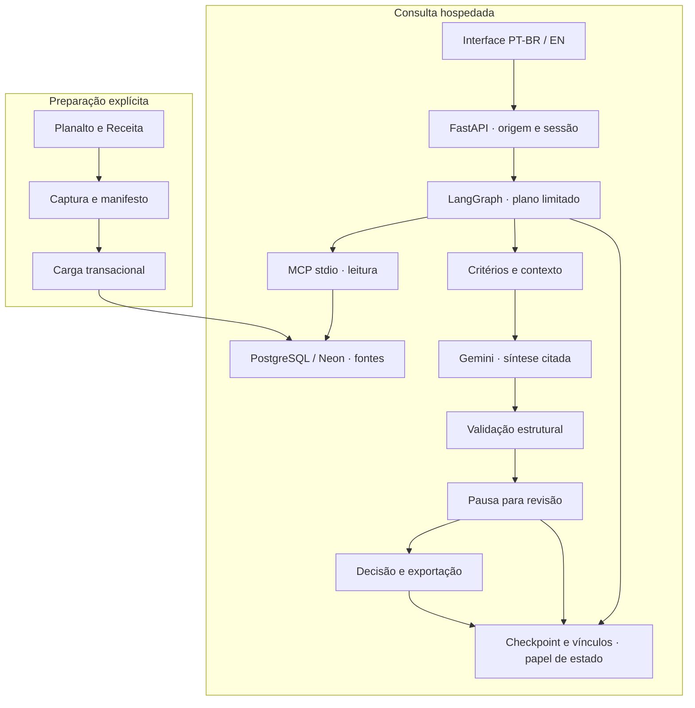

# Arquitetura e decisões de engenharia

[Visão geral](../README.md) · [Caso de uso](case-study.md) · [Qualidade](quality.md) · [Desenvolvimento](development.md)

## Visão do sistema

O navegador e a API FastAPI compartilham origem. O fluxo LangGraph usa um servidor
MCP **stdio** em subprocesso para consultas controladas, com login somente leitura.
O MCP não é um endpoint HTTP público. O servidor web gera respostas e mantém
checkpoints com um papel separado; a carga administrativa ocorre fora do runtime.

O desenho detalha o modo RAG elegível. Busca direta não chama modelo; planejamento
com IA usa Gemini para selecionar a ação, sem síntese. O RAG usa plano por regras
e até uma chamada de síntese, com até três ferramentas MCP. [Contrato do fluxo](AGENTE.md).

## Decisões e consequências

| Decisão | Motivo | Consequência e evidência |
| --- | --- | --- |
| **Captura identificada antes da IA** | Uma resposta precisa apontar para bytes e recorte conferíveis | Manifesto, carga transacional e ligação à coleta; uma captura antiga não se torna atual. [Integridade](../taxtrace/integridade.py) |
| **Consultas de domínio, sem SQL livre** | Limitar o que o planejador pode solicitar | Entradas tipadas e consultas parametrizadas; menor flexibilidade que uma pergunta SQL aberta. [Consultas](../taxtrace/consultas.py) |
| **Textual v4 como padrão** | Encontrou 19/20 e 11/12 referências; os experimentos ficaram abaixo nesses conjuntos | Mantém o prefixo da v1 e preenche vagas com v2; não melhora a ordem quando a lista já está cheia. [Comparação](../evals/COMPARACAO.md) |
| **Embeddings e RRF como alternativas explícitas** | Experimentar e medir sem trocar o padrão por novidade | E5 local, 384 dimensões e pgvector; pesos não entram na imagem pública. [Semântica](../evals/SEMANTICA.md), [híbrida](../evals/HIBRIDA.md) |
| **Síntese com citações e validação** | Vincular cada afirmação a um trecho disponível | Literalidade e identidade são verificadas; implicação semântica ainda exige revisão. [Implementação](../taxtrace/rag.py) |
| **Hash do conjunto na decisão** | Evitar decidir sobre resposta ou evidências diferentes das exibidas | Mudança de código pode exigir nova revisão; o hash não substitui autenticação. [Revisão](../taxtrace/revisao.py) |
| **Dois papéis de runtime** | Separar leitura das fontes e escrita do estado | MCP recebe apenas leitura; o servidor não recebe a credencial administrativa. [Neon](NEON.md) |
| **PostgreSQL hospedado, SQLite local opcional** | O disco efêmero do serviço Free não preserva revisões | Originais, checkpoints e vínculos ficam no Neon; histórico SQLite não foi migrado. [Persistência](PERSISTENCIA.md) |
| **Uma instância, um worker** | Limites e sessões autenticadas estão em memória | Não é arquitetura distribuída; reiniciar zera esses contadores e exige novo login. [Publicação](RENDER.md) |

## Fronteiras de confiança

1. **Fonte não é instrução:** conteúdo recuperado é dado para conferência, não
   autorização para executar ações. Regras de bloqueio não são prova de resistência
   geral a prompt injection.
2. **Modelo não decide enquadramento:** a saída é um rascunho citado, com recusas e
   erros explícitos. Os dois limites semânticos adversariais continuam documentados.
3. **Visitante não é revisor:** consulta e exportação usam vínculo do navegador;
   outra sessão não recebe o registro pelo ID. A conta de revisor tem acesso
   administrativo às revisões desse ambiente. [Autorização](AUTORIZACAO.md).
4. **Conexão de leitura não é manutenção:** destinos remotos são fixados; TLS
   `verify-full` e canal vinculado são exigidos. O preparador do Neon é um comando
   administrativo explícito, não executado pelo servidor web.
5. **Registro não é imutável contra o administrador:** grants limitam o papel da
   aplicação, mas não quem controla o banco. Checkpoint e evento são operações
   separadas; falha posterior precisa de conferência antes de repetir uma decisão.

## Mapa dos módulos

| Camada | Arquivos principais |
| --- | --- |
| Captura e domínio | [coleta.py](../taxtrace/coleta.py), [lei.py](../taxtrace/lei.py), [tabelas.py](../taxtrace/tabelas.py), [ligacao.py](../taxtrace/ligacao.py) |
| Carga e fontes | [banco.py](../taxtrace/banco.py), [schema.sql](../taxtrace/schema.sql), [fontes.py](../taxtrace/fontes.py) |
| Recuperação | [busca.py](../taxtrace/busca.py), [documentos.py](../taxtrace/documentos.py), [vetores.py](../taxtrace/vetores.py), [fusao.py](../taxtrace/fusao.py) |
| Ferramentas e fluxo | [servidor_mcp.py](../taxtrace/servidor_mcp.py), [planejamento.py](../taxtrace/planejamento.py), [agente.py](../taxtrace/agente.py), [rag.py](../taxtrace/rag.py) |
| Estado e acesso | [revisao.py](../taxtrace/revisao.py), [checkpoints.py](../taxtrace/checkpoints.py), [propriedade.py](../taxtrace/propriedade.py), [autenticacao.py](../taxtrace/autenticacao.py) |
| HTTP e operação | [web.py](../taxtrace/web.py), [publicacao.py](../taxtrace/publicacao.py), [servir.py](../taxtrace/servir.py), [estáticos](../taxtrace/static/) |

O módulo Python continua na raiz, executado com `python -m taxtrace...`. Não houve
mudança de importações, contratos ou caminhos do runtime para imitar outro projeto.
As dependências diretas estão fixadas; não se alega build idêntico byte a byte ou
lock completo das dependências transitivas.
